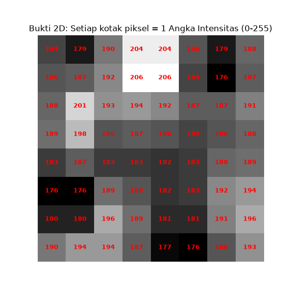
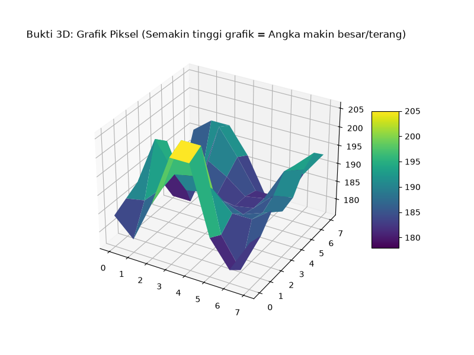
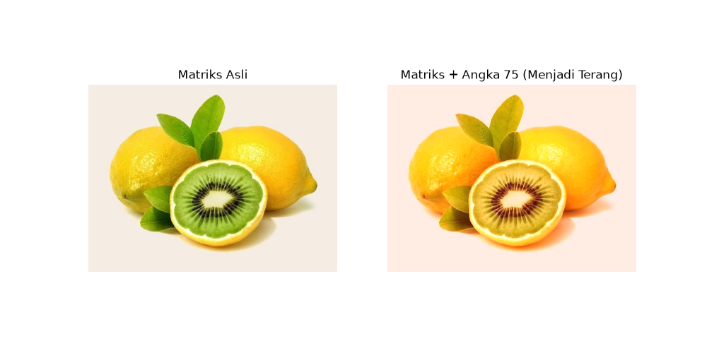

# 🔬 Analisis Mendalam: Pembuktian Citra Digital sebagai Entitas Matematis

Repository ini disusun untuk membuktikan secara terprogram bahwa sebuah gambar (citra digital) pada hakikatnya bukanlah entitas visual, melainkan **susunan matriks angka** yang dirender oleh komputer. 

Berbeda dengan pembuktian visual biasa, repository ini menggunakan **3 pendekatan validasi** sekaligus untuk membongkar anatomi gambar hingga ke tingkat byte dan topografi 3D.

## 🛠️ Persiapan & Instalasi Lingkungan Kerja
Dikembangkan menggunakan bahasa pemrograman Python dengan pustaka: `OpenCV` (Computer Vision), `NumPy` (Komputasi Matriks), dan `Matplotlib` (Visualisasi Data).

## 📊 3 Level Pembuktian

### 1. Pembuktian Fisis (Tingkat Hexadecimal)
Sebelum diproses menjadi warna di layar, file `.jpg` hanyalah rangkaian kode biner di memori. Script `pembuktian_citra.py` membuktikan hal ini dengan membaca gambar secara *raw binary bytes*:
> **Output Script:** File terdeteksi sebagai susunan angka heksadesimal (contoh: `ffd8ffe000104a464946000101000001...`)

### 2. Pembuktian Struktural (Matriks 2D & Topografi 3D)
Ketika gambar dimuat ke RAM komputer menggunakan *NumPy*, gambar dikonversi menjadi Array Multidimensi. Piksel bukan lagi titik warna, melainkan angka intensitas cahaya dari **0 (Gelap Total)** hingga **255 (Terang Maksimal)**.

Untuk membuktikannya lebih jauh secara spasial, script ini memetakan angka-angka matriks tersebut menjadi **Grafik Topografi 3D**, di mana sumbu Z (ketinggian lembah/puncak) murni diambil dari nilai angka array piksel tersebut:

### 3. Pembuktian Matematis (Filter Visual adalah Operasi Aritmatika)
Jika gambar benar-benar sekumpulan angka, maka ia bisa dikenakan operasi matematika dasar. Script ini mendemonstrasikan bahwa dengan menerapkan operasi **Penjumlahan Matriks** `(Matriks Asli + 75)`, gambar secara harfiah merespon dengan peningkatan nilai, yang dimanifestasikan layar sebagai pencerahan visual (Brightness).

